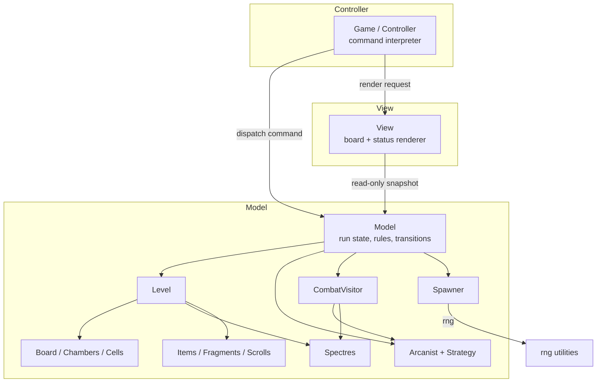
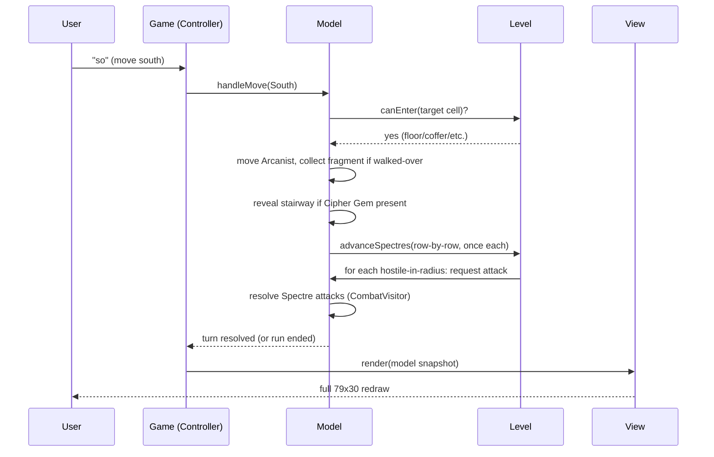
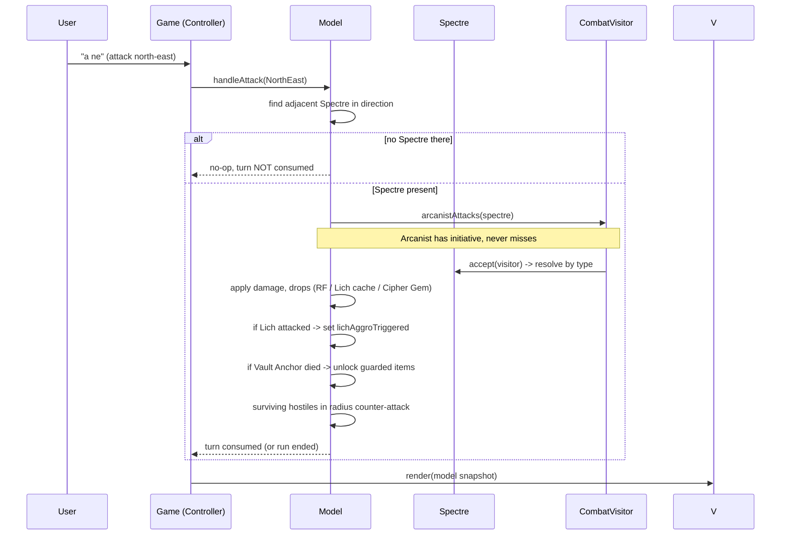
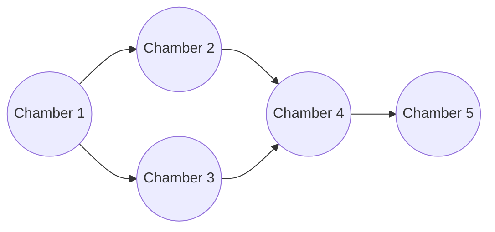
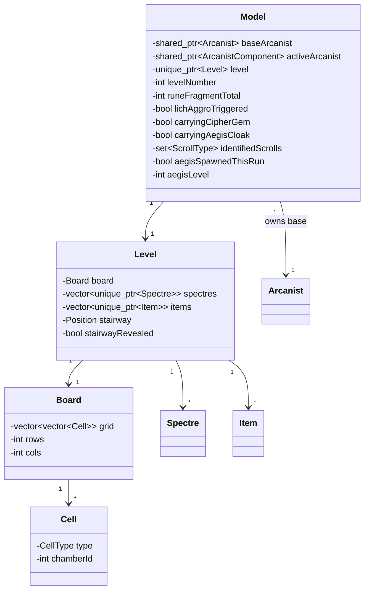
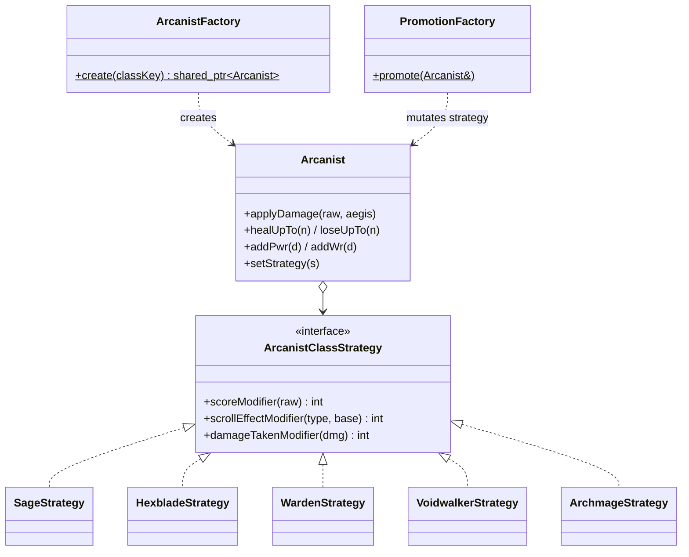
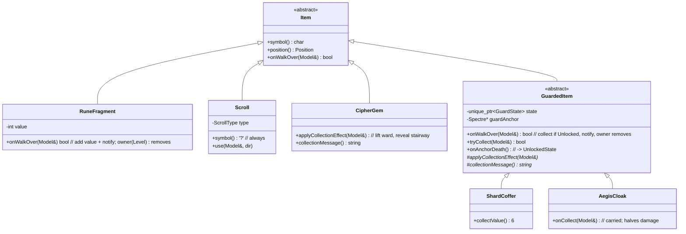
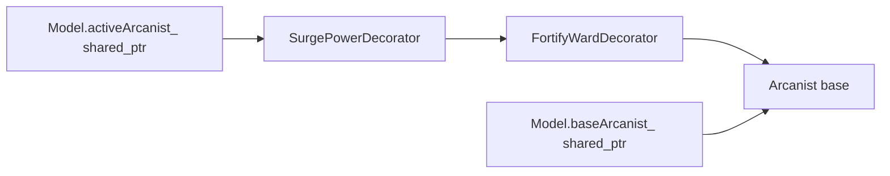
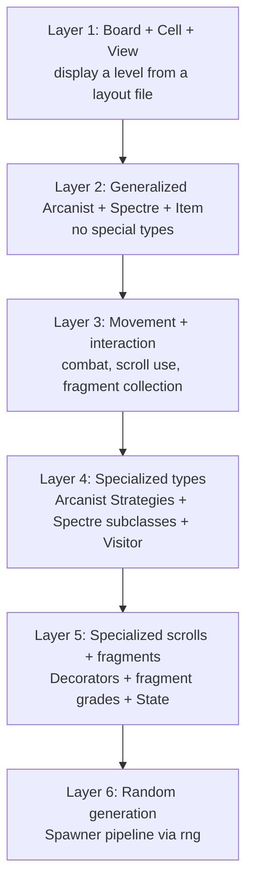

# Design Document: RuneVault

## Overview

RuneVault (RV) is a single-player, terminal-based dungeon-crawler roguelike written in C++ (targeting C++14/17). The player controls an **Arcanist** who descends through five fixed-layout vault levels, collecting **Rune Fragments**, using **Arcane Scrolls**, defeating **Spectres**, and claiming the **Shard Coffer** on each level. Winning requires reaching and descending the stairway on level 5; the run ends in loss when Focus Points (FP) reach 0.

This design covers the **full game implementation**. It is organized around a **Model-View-Controller (MVC)** architecture and layers six additional design patterns onto that backbone: **Factory Method + Strategy** for Arcanist classes, a separate **Factory Method** for Spectres, the **Visitor** pattern for Spectre combat abilities, the **Decorator** pattern for temporary scroll effects, and the **State** pattern for guarded items. All randomness routes through the provided `rng` utilities (`shuffle.h`/`shuffle.cpp`), seeded once at startup.

The design deliberately supports the spec's "If Things Go Wrong" incremental build path: a displayable level with generalized actors and movement/interaction comes first (≈50% of marks), followed by specialized types, then random generation. The layering described in [Build Order & Layering](#build-order--layering) mirrors that priority ordering so the team can deliver a runnable subset at every stage.

---

## Design Decisions & Conflict Resolutions

These decisions resolve ambiguities in the source material and record the rationale for pattern choices. They are the authoritative reference for the rest of the document.

### DD-1: Symbol conflict resolution (Scroll vs Cipher Gem)

The spec is internally inconsistent. Page 9's display table lists **`S` = Arcane Scroll** and **`?` = Cipher Gem**, while page 4, page 9's own scroll description, and Piazza Q5 state scrolls display as `?`. Piazza Q5's official fix is authoritative:

- **Arcane Scroll → `?`** (always, identified or not — the board symbol never changes)
- **Cipher Gem → `C`**

This document uses that mapping everywhere. Note the resulting collision risk: `C` is used for the Cipher Gem while the Shard **Coffer** is a rune fragment. To avoid a rendering clash we assign distinct glyphs (see [DD-7](#dd-7-final-symbol-map)). **This is a flagged design decision.**

### DD-2: Lich hostility is a single global run-scoped flag (Piazza Q1)

Lich hostility is **not** per-Lich state. The moment *any* Lich is attacked (whether it survives or dies), a single boolean `lichAggroTriggered` on the `Model` flips to `true`. From that instant, that Lich, every already-spawned Lich, and every future Lich on all levels is permanently hostile. Only a restart (`r`) resets the flag. This is modeled as run-scoped model state, queried by combat/movement logic rather than stored on individual `Lich` objects.

### DD-3: Scroll "remembered" is knowledge, not appearance (Piazza Q2)

Every scroll always renders as `?`. "Remembered" means the *game* records which scroll types have been used this run (`Model::identifiedScrolls`). On first use of a type, the effect is revealed in the status area as a discovery; on subsequent uses of an already-identified type, the effect can be reported immediately. The design must **never leak an unidentified scroll's type before first use**.

### DD-4: Walking onto guarded item tiles is allowed (Piazza Q4)

Movement onto an item tile (e.g., a Shard Coffer `C`... rendered per DD-7) is never blocked. Only **collection** is gated behind defeating the guarding Vault Anchor. Standing on a Coffer places the Arcanist adjacent to the Anchor, so the Anchor becomes hostile and attacks. The `State` pattern (LockedState → UnlockedState) governs collection, not movement.

### DD-5: Board geometry is tile-for-tile, not scaled (Piazza Q3)

The 79×30 dimension is the outer terminal bound; the bottom 5 rows are the status area, leaving a **79×25 playable region**. The level layout is drawn tile-for-tile from the figure: 5 chambers of fixed interior size (~9 columns × 4 rows) joined by fixed-length corridors. The layout is **not** stretched to fill the board.

### DD-6: Pattern selection summary and rationale

| Design Question | Chosen Pattern | Rejected Alternative | Rationale |
|---|---|---|---|
| DQ1: Arcanist classes | **Factory Method + Strategy** | Decorator | Factory centralizes creation (no scattered conditionals); Strategy makes the class ability swappable, enabling the Prestige promotion bonus. Decorator would force the client to manage wrapping. |
| DQ2: Spectre generation | **Factory Method** (separate concrete factory) | Shared AbstractFactory with Arcanist | Interfaces differ: `ArcanistFactory` takes a player class choice, `SpectreFactory` takes rng/level context. Forcing a shared base muddies both. |
| DQ3: Spectre abilities | **Visitor** (`CombatVisitor`) | Decorator on the attack | Visitor resolves combat by concrete Spectre type without permanently mutating characters and avoids many short-lived decorator objects. Tradeoff: adding a Spectre type requires touching the visitor. |
| DQ4: Temporary scroll effects | **Decorator** (shared_ptr chain) | Command with undo stack | Level transition tears down the decorator chain automatically via shared_ptr; no explicit undo history needed. |
| DQ5: Guarded items | **State** (Locked/Unlocked) | GuardedItemDecorator | Small fixed state set; each item self-drives its transition when its Anchor dies. Guarded-placement logic is shared through a common helper to avoid duplication. |
| Overall architecture | **MVC** | Observer | MVC gives a clean Controller (command interpreter) mediating between Model (state/logic) and View (rendering). Observer couples View directly to Model with more implicit indirection. |

### DD-7: Final symbol map

Because both the Cipher Gem and the Shard Coffer would otherwise want `C`, and Shade shares `S` with the old scroll symbol, the final rendering map is fixed as follows. Where the spec is silent on a clash, this document chooses distinct glyphs and flags the choice.

| Symbol | Meaning |
|---|---|
| `@` | Arcanist |
| `|` `-` | Vault walls |
| `+` | Archway |
| `#` | Corridor |
| `.` | Floor tile |
| `\` | Stairway (only after Cipher Gem picked up) |
| `?` | Arcane Scroll (all types, always) — **DD-1** |
| `*` | Rune Fragment (common, resonant, lich cache) |
| `C` | Cipher Gem — **DD-1** |
| `$` | Shard Coffer (flagged: distinct from Cipher Gem `C`) |
| `G` | Aegis Cloak |
| `W` | Wraith |
| `B` | Banshee |
| `R` | Revenant |
| `S` | Shade |
| `L` | Lich |
| `A` | Vault Anchor |
| `X` | Specter Lord |

> **Flagged decision:** The spec renders both the Shard Coffer and Cipher Gem ambiguously. We render the **Cipher Gem as `C`** (per Piazza Q5) and the **Shard Coffer as `$`** to keep them visually distinct on the tile grid. This is documented for the report and can be reverted to a single glyph if the grader prefers.

---

## Architecture

The system is split into three top-level responsibilities. The `Controller` owns the input loop and translates raw commands into `Model` operations, then asks the `View` to redraw. The `Model` holds all game state and rules. The `View` is a pure renderer that reads an immutable snapshot of the model and writes the 79×30 frame to the terminal.



**Why MVC over Observer:** The command interpreter is naturally a Controller — it consumes discrete text commands and produces state changes plus a full redraw. Because RuneVault redraws the entire board after *every* command (not incrementally), there is no need for fine-grained change notifications that Observer would provide. MVC keeps rendering logic isolated in the View, game rules isolated in the Model, and I/O parsing isolated in the Controller, which is the cleanest separation for this synchronous, redraw-everything loop.

## Components and Interfaces

### Component responsibilities

| Component | Responsibility |
|---|---|
| `Game` (Controller) | Owns the main loop, parses commands, handles class selection / restart / quit / play-again, drives the Model, requests redraws. Holds the one persistent `shared_ptr<Arcanist>` to the base Arcanist. |
| `Model` | Aggregates run-scoped state: current `Level`, the Arcanist strategy interface pointer (decorated), rune fragment total, run flags (`lichAggroTriggered`, `identifiedScrolls`, Aegis Cloak carried, Cipher Gem carried), and orchestrates combat, movement, scroll use, and level transitions. |
| `Level` | Owns the `Board` and all live actors/items for the current level; tracks the stairway location and its hidden/revealed state. |
| `Board` | Tile grid (79×25 playable) plus chamber membership; adjacency and geometry queries. |
| `Chamber` | The interior region of one of the 5 chambers; used to constrain Spectre movement and to enumerate floor tiles for spawning. |
| `Spawner` | Executes the exact spec-ordered spawning pipeline using `rng`. Consumes either random generation or a parsed layout file. |
| `View` | Renders the board frame and the 5-row status area (class, FP, Pwr, WR, RF total, identified-scroll hints, messages). |
| `LayoutLoader` | Parses the optional level-layout file (digit → item mapping) and the fixed chamber geometry. |

### Interaction: a movement command



### Interaction: an attack command



---

## Board & Level Model

### Geometry

The playable area is **79 columns × 25 rows**; the bottom 5 rows (rows 25–29 of the 30-row frame) are the status area rendered by the `View`, never part of `Board`. Coordinates use `(row, col)` with the origin at the top-left of the playable region.

**Cell types** map directly to render glyphs:

| Cell type | Glyph | Walkable | Can host actors/items |
|---|---|---|---|
| Wall | `|` `-` | no | no |
| Archway | `+` | yes | no (transit only) |
| Corridor | `#` | yes | no (transit only) |
| Floor | `.` | yes | yes |
| Stairway | `\` (hidden as `.`) | yes | no (special) |

Spectres and items may spawn **only on floor tiles** — never on archways, corridors, or the stairway. Fragments are the sole exception to "one object per cell": they are collected on walk-over, so the Arcanist may occupy their tile transiently.

### Chamber layout & connectivity

Five chambers of fixed interior size (9 cols × 4 rows) are joined by fixed-length corridors that meet chambers at archways (`+`). Connectivity (the exact tile-for-tile map is given in [Default Fixed Layout](#default-fixed-layout) below):



Every chamber is reachable from every other. Each `Cell` records its **chamber membership** (or "corridor / none"). Chamber membership is essential because:

- Spectres **cannot leave their spawn chamber**; movement candidates are filtered to same-chamber floor tiles.
- The Arcanist must not spawn in the **same chamber as the stairway**.
- Spawning distributes objects with every chamber equally likely.

### Default Fixed Layout

This is the **hardcoded built-in default layout** used when no layout file is supplied on the command line (the optional layout-file CLI argument overrides it — see [Command-line options](#command-line-options)). It is transcribed tile-for-tile from the spec figure (page 6), corrected per Piazza Q6 so that **chambers 4 and 5 are connected**. All five levels share this layout.

```
|---------|         |---------|
|.........|         |.........|
|....1....+########+....2....|
|.........|         |.........|
|----+----|         |----+----|
    #                   #
    #                   #
|----+----|         |----+----|
|.........|         |.........|
|....3....+########+....4....|
|.........|         |.........|
|---------|         |----+----|
                        #
                        #
                    |----+----|
                    |.........|
                    |....5....|
                    |.........|
                    |---------|
```

**Reading the map:**

- Each chamber interior is **9 columns wide × 4 rows tall** (the `.........` rows). The digit shown inside each chamber (`1`–`5`) marks the **chamber id** in the figure only — it is **not** part of the rendered map. Every interior cell, including the one occupied by the digit in the figure, renders as a floor tile `.`.
- **Chamber walls** use `-` (top/bottom edges) and `|` (side edges). **Archways** `+` sit on a chamber wall wherever a corridor connects to that chamber. **Corridors** are `#`.
- **Connectivity** encoded by the map matches the spec exactly (1-2, 1-3, 2-4, 3-4, 4-5):
  - Chamber **1 ↔ 2** — horizontal corridor joining the two top chambers.
  - Chamber **1 ↔ 3** — vertical corridor down the left side.
  - Chamber **2 ↔ 4** — vertical corridor down the right side.
  - Chamber **3 ↔ 4** — horizontal corridor joining the two middle chambers.
  - Chamber **4 ↔ 5** — vertical corridor down to the bottom chamber.
- The chamber-id digits in the figure correspond to the **chamber membership** assigned to each chamber's floor cells. That membership is what confines Spectre movement to the chamber of spawn and drives the equal-probability chamber distribution during spawning.
- The whole map fits within the **79×25 playable region** (the bottom 5 rows of the 79×30 board are the status area, per [DD-5](#dd-5-board-geometry-is-tile-for-tile-not-scaled)).

### 8-direction geometry helpers

A single `Direction` enum and a `Geometry` utility centralize all adjacency math so the "1-block radius = 8 adjacent cells" rule is defined in exactly one place.

```cpp
enum class Direction { No, So, Ea, We, Ne, Nw, Se, Sw };

struct Position {
    int row;
    int col;
    bool operator==(const Position&) const;
};

namespace Geometry {
    // The 8 offsets for the 8 compass directions.
    Position step(const Position& p, Direction d);          // one cell in direction d
    std::array<Position, 8> neighbours(const Position& p);  // the 1-block radius
    bool isAdjacent(const Position& a, const Position& b);   // within 1-block radius
    Direction parse(const std::string& token);              // "no".."sw" -> Direction
}
```

### Movement & interaction rules encoded in the model

- **Fragment walk-over:** entering a fragment tile adds its value to the RF total immediately and removes the fragment.
- **Guarded item walk-over:** entering a Shard Coffer / Aegis Cloak tile is allowed (DD-4); collection only succeeds if the item's `State` is Unlocked.
- **Stairway:** hidden (renders as floor) until the Cipher Gem is carried; then renders `\`. Descending on level 5 wins; descending on levels 1–4 transitions to the next level.
- **`a <dir>` with no adjacent Spectre:** no effect, **turn not consumed** (Spectres do not advance).

## Data Models



---

## Arcanist: Factory Method + Strategy

### Rationale (DQ1)

The `Arcanist` is a single **non-abstract** class holding stats (FP, Pwr, WR) and a pointer to an `ArcanistClassStrategy`. The strategy encapsulates the four class abilities so no `switch(classType)` conditionals leak into combat, scoring, or scroll code. A **Factory Method** builds a base Arcanist with the correct strategy attached; adding a fifth class means adding one strategy subclass and one factory branch — no changes to combat/scoring/scroll logic. A second **promotion factory** swaps the strategy in place to implement the Prestige bonus (Sage → Archmage).

### Strategy interface

The strategy exposes exactly the three hook points the class abilities need. Each default (base) implementation is the identity transform, so a class with no ability in a given hook simply inherits the default.

```cpp
class ArcanistClassStrategy {
public:
    virtual ~ArcanistClassStrategy() = default;

    // Sage: +50% at end-game scoring. Others: identity.
    virtual int    scoreModifier(int rawFragmentTotal) const = 0;

    // Hexblade: double magnitude. Voidwalker: 50% chance negative->positive.
    // Applied to a scroll's signed delta before it is applied to stats/FP.
    virtual int    scrollEffectModifier(ScrollType type, int baseDelta) const = 0;

    // Warden: reduce incoming damage by 1 (min 1), applied per damage ordering.
    virtual int    damageTakenModifier(int incomingDamage) const = 0;

    virtual std::string className() const = 0;
    virtual char   classKey() const = 0; // 's','h','w','v'
};
```

Concrete strategies: `SageStrategy`, `HexbladeStrategy`, `WardenStrategy`, `VoidwalkerStrategy`, plus the promotion strategy `ArchmageStrategy` (Prestige bonus). `VoidwalkerStrategy::scrollEffectModifier` uses `rng::chance(0.5)` to flip a negative delta to positive.

### Arcanist class

```cpp
class Arcanist {
public:
    Arcanist(int fp, int pwr, int wr, std::unique_ptr<ArcanistClassStrategy> s);

    // Stats
    int  fp() const;   int maxFp() const;   int pwr() const;   int wr() const;
    void applyDamage(int rawDamage, bool aegis);   // routes through strategy + aegis ordering
    void healUpTo(int amount);                     // Attune Focus (permanent, capped at max)
    void loseUpTo(int amount);                     // Drain Focus (permanent, floored at 0)

    // Strategy access (used by scoring / scroll / combat)
    const ArcanistClassStrategy& strategy() const;
    void  setStrategy(std::unique_ptr<ArcanistClassStrategy> s); // promotion factory uses this

    // Stat mutation for temporary scrolls; the base is restored when the
    // decorator chain is torn down at level transition (see Decorator section).
    void addPwr(int delta);  void addWr(int delta);

private:
    int fp_, maxFp_, pwr_, wr_;
    std::unique_ptr<ArcanistClassStrategy> strategy_;
};
```

### Factories

```cpp
// Creation factory: player class choice -> base Arcanist with strategy.
class ArcanistFactory {
public:
    static std::shared_ptr<Arcanist> create(char classKey); // 's','h','w','v'
};

// Promotion factory (Prestige bonus): swaps the strategy on an existing Arcanist.
// Kept separate so the base game never depends on promotion logic.
class PromotionFactory {
public:
    static void promote(Arcanist& a); // e.g. Sage -> Archmage after level 3
};
```

### Class diagram



### Base stats table (for factory)

| Class | Key | FP | Pwr | WR | Ability hook |
|---|---|---|---|---|---|
| Sage | `s` | 120 | 18 | 18 | `scoreModifier`: ×1.5 |
| Hexblade | `h` | 100 | 24 | 14 | `scrollEffectModifier`: ×2 magnitude |
| Warden | `w` | 150 | 16 | 22 | `damageTakenModifier`: −1 (min 1) |
| Voidwalker | `v` | 110 | 22 | 12 | `scrollEffectModifier`: 50% negative→positive |

---

## Spectres: Factory Method + Visitor

### Spectre hierarchy (DQ2)

`Spectre` is an **abstract base class**. Concrete subclasses hold the per-type stats and identity. Unlike the Arcanist, Spectres need **no Strategy** (no promotion mechanic), so the hierarchy is straightforward inheritance. The `SpectreFactory` is a **separate concrete factory** from `ArcanistFactory` — it takes rng/level context, not a player choice, so sharing an abstract-factory base would muddy both interfaces (DD-6).

```cpp
enum class SpectreType { Wraith, Banshee, Revenant, Shade, Lich, VaultAnchor, SpecterLord };

class Spectre {
public:
    Spectre(SpectreType t, int fp, int pwr, int wr, int spawnChamber, Position pos);
    virtual ~Spectre() = default;

    // Combat: Spectre-specific ability resolution via Visitor (double-dispatch).
    virtual void accept(CombatVisitor& v) = 0;

    // Identity & rendering
    virtual char  symbol() const = 0;
    SpectreType   type() const;

    // Stats
    int  fp() const; int pwr() const; int wr() const;
    void takeDamage(int dmg);         // reduces FP
    bool isDead() const;

    // Movement constraints
    int       spawnChamber() const;   // may never leave this chamber
    Position  position() const;
    void      moveTo(Position p);
    virtual bool isMobile() const;    // false for VaultAnchor

    // Drops (default 1 RF; overridden by Lich=cache 4, Anchor=none)
    virtual int runeDrop() const;

    // Hostility (see CombatVisitor / Model for Lich + Anchor special cases)
    virtual bool isDefaultHostile() const; // false for Lich & VaultAnchor
};
```

Concrete subclasses: `Wraith`, `Banshee`, `Revenant`, `Shade`, `Lich`, `VaultAnchor`, `SpecterLord`. `VaultAnchor::isMobile()` returns `false`; `Lich` and `VaultAnchor` override `isDefaultHostile()` → `false`.

### Stats & drops table

| Spectre | Symbol | FP | Pwr | WR | Mobile | Default hostile | Drop |
|---|---|---|---|---|---|---|---|
| Wraith | `W` | 60 | 20 | 10 | yes | yes | 1 RF |
| Banshee | `B` | 40 | 30 | 5 | yes | yes | 1 RF |
| Revenant | `R` | 100 | 18 | 20 | yes | yes | 1 RF |
| Shade | `S` | 50 | 8 | 8 | yes | yes | 1 RF |
| Lich | `L` | 30 | 40 | 5 | yes | no (until aggro) | Lich cache = 4 |
| Vault Anchor | `A` | 120 | 22 | 18 | no | no (only if adjacent to Coffer) | none |
| Specter Lord | `X` | 80 | 28 | 15 | yes | yes | 1 RF |

### CombatVisitor (DQ3)

Special abilities (Wraith FP drain, Banshee temporary Warding reduction, Shade rune-fragment theft, etc.) are resolved by a **Visitor** so combat outcomes vary by concrete Spectre type **without permanently mutating** the Arcanist. The visitor carries references to the `Arcanist` and `Model` and applies temporary/contextual effects at resolution time.

```cpp
class CombatVisitor {
public:
    CombatVisitor(Model& model, ArcanistComponent& arcanist);

    // One overload per concrete Spectre type (double-dispatch via accept()).
    virtual void visit(Wraith&);       // e.g. bonus FP drain on hit
    virtual void visit(Banshee&);      // e.g. temporary WR reduction for this exchange
    virtual void visit(Revenant&);
    virtual void visit(Shade&);        // e.g. steal a rune fragment on hit
    virtual void visit(Lich&);         // trips lichAggroTriggered when attacked
    virtual void visit(VaultAnchor&);  // unlocks guarded items on death
    virtual void visit(SpecterLord&);

private:
    Model& model_;
    ArcanistComponent& arcanist_;
};
```

**Tradeoff (documented):** adding a new Spectre type requires adding a `visit` overload to `CombatVisitor` and every concrete visitor. This is the accepted cost of keeping combat logic out of the Spectre data classes and avoiding the many short-lived objects a per-attack Decorator would create.

### SpectreFactory

```cpp
class SpectreFactory {
public:
    // Random spawn honoring the spec distribution (excludes Vault Anchor).
    // Uses rng::weighted with the weights below.
    std::unique_ptr<Spectre> createRandom(int chamberId, Position pos) const;

    // Explicit creation (used by layout files and Vault Anchor placement).
    std::unique_ptr<Spectre> create(SpectreType t, int chamberId, Position pos) const;
};
```

Spawn distribution weights passed to `rng::weighted` (order: Wraith, Banshee, Shade, Revenant, Specter Lord, Lich):

| Spectre | Probability | Weight (×18) |
|---|---|---|
| Wraith | 2/9 | 4 |
| Banshee | 3/18 | 3 |
| Shade | 5/18 | 5 |
| Revenant | 1/9 | 2 |
| Specter Lord | 1/9 | 2 |
| Lich | 1/9 | 2 |

Weights `{4, 3, 5, 2, 2, 2}` sum to 18, matching the spec fractions exactly.

### Spectre movement algorithm

```cpp
// Called once per Arcanist action, after the Arcanist has acted.
// Spectres processed row-by-row, left-to-right; each moved at most once.
```

```pascal
ALGORITHM advanceSpectres(level, arcanistPos)
BEGIN
  FOR each spectre IN level.spectres ORDERED BY (row ASC, col ASC) DO
    IF spectre.isDead() THEN CONTINUE

    hostile := isHostile(spectre, arcanistPos)   // see hostility rules
    IF hostile AND Geometry.isAdjacent(spectre.pos, arcanistPos) THEN
      // Attack instead of moving; 50% miss handled in resolveSpectreAttack
      resolveSpectreAttack(spectre)
    ELSE IF spectre.isMobile() THEN
      candidates := unoccupiedFloorTilesInChamber(spectre.spawnChamber,
                                                  Geometry.neighbours(spectre.pos))
      IF candidates NOT EMPTY THEN
        spectre.moveTo(rng.pick(candidates))
      END IF
    END IF
  END FOR
END
```

Hostility resolution:

```pascal
FUNCTION isHostile(spectre, arcanistPos) RETURNS bool
BEGIN
  IF spectre.type = VaultAnchor THEN
    RETURN arcanistAdjacentToGuardedCoffer(spectre)
  ELSE IF spectre.type = Lich THEN
    RETURN model.lichAggroTriggered
  ELSE
    RETURN true
  END IF
END
```

---

## Items: Hierarchy + Guarded-Item State

### Item hierarchy (DQ5)

All placeable non-Spectre objects share an `Item` base to reuse placement and rendering. Rune Fragments, Scrolls, the Cipher Gem, and the guarded Major Items (Shard Coffer, Aegis Cloak) all derive from it. Guarded-placement logic is shared through a single `GuardedItem` intermediate that owns the `State` machine and a reference to its Vault Anchor — the Shard Coffer and Aegis Cloak do **not** duplicate it.



### Rune Fragment types

| Type | Value | Notes |
|---|---|---|
| Common shard | 1 | probability 5/7 among the 9 non-Coffer piles |
| Resonant shard | 2 | probability 2/7 |
| Lich cache | 4 | dropped on Lich defeat only |
| Shard Coffer | 6 | one per level, guarded (a `GuardedItem`) |

Common vs resonant is chosen with `rng::weighted({5, 2})`.

### Guarded-item State pattern (DQ5, DD-4)

```cpp
class GuardState {
public:
    virtual ~GuardState() = default;
    // Returns true and yields the item's value if collection is permitted.
    virtual bool tryCollect(GuardedItem& item, Model& model) = 0;
    virtual bool isLocked() const = 0;
};

class LockedState : public GuardState {   // Anchor alive -> collection fails
    bool tryCollect(GuardedItem&, Model&) override; // returns false
    bool isLocked() const override { return true; }
};

class UnlockedState : public GuardState { // Anchor dead -> collection succeeds
    bool tryCollect(GuardedItem&, Model&) override; // adds value / equips, removes item
    bool isLocked() const override { return false; }
};
```

```cpp
class GuardedItem : public Item {
public:
    GuardedItem(Position pos, Spectre* anchor);
    void onAnchorDeath();          // state = make_unique<UnlockedState>()
    bool tryCollect(Model& model); // delegates to current state
    // Movement onto the tile is always allowed (DD-4); only tryCollect is gated.
protected:
    std::unique_ptr<GuardState> state_ = std::make_unique<LockedState>();
    Spectre* guardAnchor_;         // non-owning; Anchor lives in Level::spectres
};
```

The `CombatVisitor::visit(VaultAnchor&)` (on Anchor death) walks the level's guarded items and calls `onAnchorDeath()` on the one(s) it guards. `guardAnchor_` is a **non-owning raw pointer** — the Anchor is owned by `Level`; the item only observes it.

**Walk-over dispatch (no RTTI).** `Item::onWalkOver(Model&)` returns a `bool` meaning "was I consumed?". `Model::moveArcanist` dispatches uniformly — `if (item->onWalkOver(*this)) level_->removeItemAt(pos)` — with no `dynamic_cast`/type-switch. Each subclass owns its own effect, notification, and consumed/kept decision: `RuneFragment` credits its value + notifies + returns true; `Scroll` is a no-op returning false (it is used via `u <dir>`); `GuardedItem::onWalkOver` calls `tryCollect` and, on a successful collect, emits its `collectionMessage()` and returns true. Crucially the item **never deletes itself** — the owning `Level` performs the physical removal, keeping creation and deletion in the owner. The `collectionMessage()` hook lives outside `applyCollectionEffect` so the Anchor-death in-place collection path (which calls `tryCollect` directly) stays silent, while only the walk-over path announces the pickup.

---

## Arcane Scrolls: Decorator for Temporary Effects

### Rationale (DQ4)

Two scroll effects are **permanent** (Attune Focus +FP, Drain Focus −FP) and are applied directly to the base `Arcanist`. The four **current-level-only** effects (Surge Power, Fortify Ward, Sap Power, Erode Ward) are modeled with the **Decorator** pattern so that a level transition tears them all down automatically — no explicit per-level tracking of used scrolls is needed.

### Component interface & ownership model

`ArcanistComponent` is the common interface implemented by both the base `Arcanist` (adapted) and each `ScrollDecorator`. The `Model` holds:

- `shared_ptr<Arcanist> baseArcanist_` — the **one persistent owner** of the base object.
- `shared_ptr<ArcanistComponent> activeArcanist_` — points to the **head** of the decorator chain (or directly at the base when no temporary effects are active).

```cpp
class ArcanistComponent {
public:
    virtual ~ArcanistComponent() = default;
    virtual int  effPwr() const = 0;   // effective Pwr including active buffs/debuffs
    virtual int  effWr()  const = 0;   // effective WR  including active buffs/debuffs
    virtual Arcanist& base() = 0;      // reach the underlying base for FP/strategy
};

class ScrollDecorator : public ArcanistComponent {
public:
    explicit ScrollDecorator(std::shared_ptr<ArcanistComponent> inner);
    Arcanist& base() override { return inner_->base(); }
protected:
    std::shared_ptr<ArcanistComponent> inner_; // shared_ptr chain toward base
};

class SurgePowerDecorator  : public ScrollDecorator { int effPwr() const override; }; // +5
class FortifyWardDecorator : public ScrollDecorator { int effWr()  const override; }; // +5
class SapPowerDecorator    : public ScrollDecorator { int effPwr() const override; }; // -5 (floor 0)
class ErodeWardDecorator   : public ScrollDecorator { int effWr()  const override; }; // -5 (floor 0)
```

### Ownership & teardown (shared_ptr chain)



- Applying a temporary scroll wraps the current `activeArcanist_`: `activeArcanist_ = make_shared<SurgePowerDecorator>(activeArcanist_)`.
- On **level transition**, the Model resets the chain head: `activeArcanist_ = baseArcanist_`. Every decorator's refcount drops to zero and the chain is destroyed top-down, leaving only the base Arcanist alive (still owned by `baseArcanist_`). Permanent FP changes stay on the base and survive.
- This is why the base is held by a **separate** `shared_ptr` (`baseArcanist_`): it guarantees the base outlives any teardown of the decorator chain.

### Scroll effect application (with class modifiers)

```pascal
ALGORITHM useScroll(scroll, model)
BEGIN
  baseDelta := signedBaseDelta(scroll.type)   // e.g. SP:+5, SaP:-5, AF:+10, DF:-10
  // Hexblade doubles magnitude; Voidwalker may flip negative->positive (rng 50%)
  delta := arcanist.strategy().scrollEffectModifier(scroll.type, baseDelta)

  SWITCH scroll.type
    CASE AttuneFocus: arcanist.base().healUpTo(delta)      // permanent, cap at max
    CASE DrainFocus:  arcanist.base().loseUpTo(-delta)     // permanent, floor 0
    CASE SurgePower:  activeArcanist := wrap(SurgePowerDecorator)
    CASE FortifyWard: activeArcanist := wrap(FortifyWardDecorator)
    CASE SapPower:    activeArcanist := wrap(SapPowerDecorator)
    CASE ErodeWard:   activeArcanist := wrap(ErodeWardDecorator)
  END SWITCH

  identifyScroll(scroll.type)   // DD-3: record as remembered for the run
  removeScrollFromBoard(scroll)
END
```

> Note: for the debuff decorators (`SapPower`, `ErodeWard`) the "cannot fall below 0" floor is applied inside `effPwr()`/`effWr()` (`max(0, ...)`), so the decorator model and the floor rule compose cleanly. Hexblade's doubling and Voidwalker's flip are handled uniformly through `scrollEffectModifier`, which for temporary scrolls adjusts the decorator's magnitude/sign at construction.

---

## Combat Resolution

### Rules summary

- **Initiative:** the Arcanist always attacks first and **never misses**.
- **Spectre auto-attack:** when the Arcanist is within a 1-block radius of a hostile Spectre, that Spectre attacks instead of moving; **50% miss** via `rng::chance(0.5)`.
- **Vault Anchor:** hostile **only** when the Arcanist is adjacent to its Shard Coffer (DD-4).
- **Lich:** non-hostile until `lichAggroTriggered` (DD-2); attacking any Lich trips the global flag.
- Spectres **never pursue** (base game).

### Damage formula

```
Damage(Defender) = ceil( (100 / (100 + WR(Defender))) * Pwr(Attacker) )
```

Effective Pwr/WR come from `ArcanistComponent::effPwr()/effWr()` (buffs applied) for the Arcanist and from the concrete Spectre stats for Spectres.

### Damage-taken ordering (Warden + Aegis)

Applied strictly in this order when the Arcanist is the defender:

```pascal
FUNCTION incomingDamageToArcanist(rawDamage) RETURNS int
BEGIN
  d := rawDamage
  // 1. Warden -1 (only Warden strategy changes this; others identity)
  d := arcanist.strategy().damageTakenModifier(d)   // Warden: d - 1
  // 2. Aegis Cloak halves, rounding up
  IF model.carryingAegisCloak THEN
    d := ceil(d / 2)
  END IF
  // 3. Minimum of 1 when any reduction applied
  RETURN max(1, d)
END
```

This matches the spec worked example: base 4 → Warden → 3 → halve-round-up → 2 → max(1,2) = 2. For a pure Warden without Aegis: `max(1, raw - 1)`. For pure Aegis without Warden: `max(1, ceil(raw/2))` (min-1 guards against a 0 result).

### Arcanist attack resolution

```pascal
ALGORITHM resolveArcanistAttack(targetSpectre)
BEGIN
  dmg := ceil( (100 / (100 + targetSpectre.wr)) * arcanist.effPwr() )
  targetSpectre.takeDamage(dmg)                 // never misses

  visitor := CombatVisitor(model, arcanist)
  targetSpectre.accept(visitor)                  // type-specific side effects

  IF targetSpectre.type = Lich THEN
    model.lichAggroTriggered := true             // DD-2 (attack, hit or not)
  END IF

  IF targetSpectre.isDead() THEN
    IF targetSpectre.type = Lich THEN
      model.runeFragmentTotal += 4               // Lich cache
    ELSE IF targetSpectre.type = VaultAnchor THEN
      unlockGuardedItemsFor(targetSpectre)        // State -> Unlocked
    ELSE
      model.runeFragmentTotal += 1               // standard drop
    END IF
    // If this Spectre carried the Cipher Gem, drop it on its tile.
    IF targetSpectre.carriesCipherGem THEN dropCipherGem(targetSpectre.pos)
    removeSpectre(targetSpectre)
  END IF
END
```

### Spectre attack resolution

```pascal
ALGORITHM resolveSpectreAttack(spectre)
BEGIN
  IF rng.chance(0.5) THEN RETURN            // 50% miss
  raw := ceil( (100 / (100 + arcanist.effWr())) * spectre.pwr )
  dmg := incomingDamageToArcanist(raw)      // Warden/Aegis/min-1 ordering
  arcanist.base().reduceFp(dmg)
  IF arcanist.base().fp() <= 0 THEN model.endRun(LOSS)
END
```

---

## Spawning Pipeline

The `Spawner` executes the **exact spec-ordered** pipeline using only `rng`. Every chamber is equally likely; within a chosen chamber, every floor tile is equally likely. **No two objects share a cell** except fragments (walk-over). Spectres/items spawn on floor tiles only.

### Order (authoritative)

1. **Arcanist location** — random floor tile in any chamber **except** the stairway's chamber.
2. **Stairway location** — random floor tile; its chamber must differ from the Arcanist's. Hidden until Cipher Gem carried.
3. **Scrolls** — 10 per level; each of the 6 types with equal probability (`rng::weighted({1,1,1,1,1,1})` or `rng::range`).
4. **Rune fragments** — 1 Shard Coffer (`$`) + its guarding Vault Anchor placed within a 1-block radius; then 9 piles, each common (5/7) or resonant (2/7) via `rng::weighted({5,2})`.
5. **Spectres** — 20 per level via `SpectreFactory::createRandom` using the distribution weights `{4,3,5,2,2,2}`; each assigned a random chamber and a random unoccupied floor tile within it.

### Cross-cutting placements

- **Cipher Gem:** after spectres are placed, one **non-Vault-Anchor** Spectre is chosen uniformly at random (`rng::pick`) to carry the Cipher Gem for that level.
- **Aegis Cloak:** exactly once per run, on a random level in 2–4 (chosen at run start via `rng::range(2,4)`). On that level it uses the **shared guarded-placement helper** (same as the Shard Coffer): placed on a floor tile with a guarding Vault Anchor within 1-block radius.

### Shared guarded-placement helper (no duplication — DQ5)

```cpp
// Places a guarded item + its Vault Anchor. Reused by Shard Coffer and Aegis Cloak.
class Spawner {
    // Returns the placed GuardedItem; wires the Anchor reference into it.
    GuardedItem* placeGuarded(Level& level,
                              std::function<std::unique_ptr<GuardedItem>(Position, Spectre*)> make);
    // ... location pickers using rng, chamber enumeration, occupancy checks ...
};
```

### Occupancy invariant

```pascal
FUNCTION pickFreeFloorTile(chamber) RETURNS Position
BEGIN
  tiles := floorTilesOf(chamber) WHERE NOT occupied(tile)
  ASSERT tiles NOT EMPTY
  RETURN rng.pick(tiles)   // uniform within chamber
END
```

---

## Level Transition & Run Lifecycle

### Ward, stairway, and descent

- The **Ward** on the descent is lifted only while the Arcanist **carries the Cipher Gem** for the current level.
- The **stairway** renders as floor (`.`) until the Cipher Gem is picked up; then it renders `\`.
- Walking onto the stairway tile **without** the Gem has no effect.
- Descending with the Gem: levels 1–4 → advance to next level; level 5 → **win**.

### Transition procedure

```pascal
ALGORITHM descend(model)
BEGIN
  IF NOT model.carryingCipherGem THEN RETURN   // ward still up

  IF model.levelNumber = 5 THEN
    model.endRun(WIN)
    RETURN
  END IF

  // 1. Tear down temporary scroll decorators (permanent FP changes remain on base).
  model.activeArcanist := model.baseArcanist

  // 2. Reset per-level carry state.
  model.carryingCipherGem := false
  // Aegis Cloak persists across levels once collected (carried item), so NOT reset.

  // 3. Build the next level (random or from layout file) and place the Arcanist.
  model.levelNumber += 1
  model.level := buildLevel(model.levelNumber)
END
```

### Run-end handling

A run ends on win (level-5 descent), loss (FP ≤ 0), restart (`r`), or quit (`q`). On win, the score is computed and shown; then the play-again prompt is offered. On loss, the play-again prompt is offered.

### Scoring (win only)

```pascal
FUNCTION finalScore(model) RETURNS int
BEGIN
  // Sage: +50%. Others: identity. Routed through the strategy so no conditionals.
  RETURN arcanist.strategy().scoreModifier(model.runeFragmentTotal)
END
```

---

## Command Interpreter (Controller)

The `Game` runs a synchronous read-eval-render loop. The board redraws **completely after every command**.

### Command set

| Command | Effect |
|---|---|
| `s` `h` `w` `v` | Select Arcanist class (only valid at game start / after restart). |
| `no so ea we ne nw se sw` | Move one cell in that direction; may collect a fragment, reveal stairway, or descend. Then Spectres advance. |
| `u <dir>` | Use the scroll within 1-block radius in `<dir>` (e.g. `u no`). Applies effect, identifies type (DD-3). |
| `a <dir>` | Attack the immediately-adjacent Spectre in `<dir>`. **No-op and turn not consumed** if none there. |
| `r` | Restart the run: full reset of stats, scrolls, RF total, **and `lichAggroTriggered`** (DD-2). Requires a new class selection. |
| `q` | Quit the game. |

### Main loop

```pascal
ALGORITHM run(argv)
BEGIN
  config := parseArgs(argv)                // optional layout file, optional seed
  IF config.hasSeed THEN rng.seed(config.seed) ELSE rng.seed_from_time()

  LOOP
    class := promptClassSelectionOrQuit()  // s/h/w/v or q
    IF class = QUIT THEN BREAK

    model := newRun(class, config)
    view.render(model)

    WHILE model.runActive DO
      cmd := readCommand()
      SWITCH cmd
        CASE MOVE(dir):   model.handleMove(dir)
        CASE USE(dir):    model.handleUseScroll(dir)
        CASE ATTACK(dir): consumed := model.handleAttack(dir)   // may be no-op
        CASE RESTART:     model.restart()   // resets lichAggroTriggered
        CASE QUIT:        RETURN
      END SWITCH
      view.render(model)                    // full redraw every command
    END WHILE

    // Run ended (win/loss/restart)
    IF model.endState = WIN THEN view.showScore(finalScore(model))
    IF NOT playAgainPrompt() THEN BREAK
  END LOOP
END
```

### Command-line options

- **Level-layout file (optional, 1st arg):** provides the exact layout of all five levels minus the 5 status rows. Digits `0-9` map to scrolls/fragments per the spec table:

  | Digit | Item | Digit | Item |
  |---|---|---|---|
  | 0 | AF scroll | 5 | EW scroll |
  | 1 | SP scroll | 6 | Common shard |
  | 2 | FW scroll | 7 | Resonant shard |
  | 3 | DF scroll | 8 | Lich cache |
  | 4 | SaP scroll | 9 | Shard Coffer |

  `LayoutLoader` parses the file into `Cell` grids + explicit item placements; the `Spawner` then bypasses random generation for those aspects the file specifies.

- **Seed (optional, 2nd arg):** forwarded to `rng::seed` for reproducible runs.

---

## Bonus Feature Seams

The spec forbids recompilation-with-flags to toggle bonus features, so both must be reachable at runtime through existing seams.

### Prestige system (Strategy swap)

The `PromotionFactory::promote(Arcanist&)` swaps the `ArcanistClassStrategy` (e.g. `SageStrategy` → `ArchmageStrategy`) once the run reaches level 3. Because the ability lives entirely in the strategy, no combat/scoring/scroll code changes. The promotion is a runtime event, satisfying the "no recompilation flags" constraint.

### Spectre intelligence / pursuit (Strategy for AI)

Movement behavior is designed behind a `MovementBehavior` Strategy so pursuit can be added without altering `Spectre`:

```cpp
class MovementBehavior {
public:
    virtual ~MovementBehavior() = default;
    virtual Position nextMove(const Spectre&, const Board&, const Position& arcanist) = 0;
};
class WanderingBehavior : public MovementBehavior { /* random in-chamber (base game) */ };
class PursuitBehavior   : public MovementBehavior { /* A*/Dijkstra across corridors */ };
```

Base-game Spectres use `WanderingBehavior`; a smarter Spectre can be assigned `PursuitBehavior`, swapped dynamically when the Arcanist enters line of sight. The A*/Dijkstra pathfinding runs over the `Board` graph. This seam is designed now; the base game ships `WanderingBehavior` only.

---

## Build Order & Layering

The design supports the spec's "If Things Go Wrong" incremental priority. Each layer is independently runnable, so partial submissions still compile and demo.



- **Layers 1–3 (≈50%):** a displayable level, a general-purpose Arcanist/Spectre/Item, and movement + interaction. Uses the layout file for placement, so random generation is not yet required.
- **Layer 4:** introduce `ArcanistClassStrategy` + factories and the concrete `Spectre` subclasses + `CombatVisitor`.
- **Layer 5:** add `ScrollDecorator` chain, fragment grades, and the guarded-item `State`.
- **Layer 6:** replace file placement with the `Spawner` random pipeline.

---

## Memory Management & RAII

- **Base Arcanist:** owned by `Model::baseArcanist_` (`shared_ptr<Arcanist>`); the decorator chain head is `Model::activeArcanist_` (`shared_ptr<ArcanistComponent>`). Level transition resets the head to the base, tearing down decorators deterministically while the base survives (see [Decorator ownership](#ownership--teardown-shared_ptr-chain)).
- **Level-owned actors/items:** `Level` owns `vector<unique_ptr<Spectre>>` and `vector<unique_ptr<Item>>`. They are destroyed automatically when the `Level` is replaced on transition or restart.
- **Non-owning references:** `GuardedItem::guardAnchor_` and `CombatVisitor`'s references are raw pointers/references — they observe, never own. Anchors are owned by `Level::spectres`.
- **No manual `new`/`delete`:** all heap allocation goes through `make_shared`/`make_unique`; RAII guarantees no leaks, satisfying the "must compile and run" grading emphasis.
- **Strategy objects:** `unique_ptr<ArcanistClassStrategy>` owned by the `Arcanist`; swapping on promotion releases the old strategy automatically.

---

## Error Handling

| Scenario | Condition | Response | Recovery |
|---|---|---|---|
| Invalid command token | Input not in the command set (e.g. typo) | Ignore; show a brief status hint; do not consume a turn | Re-prompt on next loop iteration |
| `a <dir>` with no adjacent Spectre | No Spectre in the specified adjacent cell | No-op; **turn not consumed**; Spectres do not advance (Property 11) | Player issues another command |
| `u <dir>` with no scroll in radius | No scroll within 1-block radius in `<dir>` | No-op; status message; turn not consumed | Player repositions or retries |
| Move into wall/out of bounds | Target cell is a wall or outside the playable region | Reject move; turn not consumed | Player chooses a valid direction |
| Class selection before run | Non `s/h/w/v/q` input at the class prompt | Re-prompt without starting a run | Player selects a valid class |
| Layout file missing/malformed | File path invalid or digit outside `0-9` / geometry mismatch | Fail fast at startup with a clear message; fall back to random generation if unspecified aspects | User fixes the file or omits the argument |
| Invalid seed argument | Non-numeric seed | Report and seed from time instead | Continue with a non-reproducible run |
| FP reaches 0 mid-combat | Damage brings FP ≤ 0 | End run as LOSS immediately; render final frame | Offer play-again prompt |
| Empty free-tile set during spawning | A chamber has no unoccupied floor tile | Assertion/guard; spawner retries other chambers before failing | Layout/parameters corrected (should not occur with the fixed layout) |

Movement onto a guarded item tile is **not** an error (DD-4): it is allowed, and only collection is gated. Walking onto the hidden stairway without the Cipher Gem is a silent no-op, not an error.

## Correctness Properties

*A property is a characteristic or behavior that should hold true across all valid executions of a system — essentially, a formal statement about what the system should do. Properties serve as the bridge between human-readable specifications and machine-verifiable correctness guarantees.*

These are the invariants the implementation must uphold; they double as the basis for the test plan. Each property is annotated with the requirement acceptance criteria it validates.

### Property 1: Damage formula non-negativity
For all attacker Pwr ≥ 0 and defender WR ≥ 0, `Damage = ceil(100/(100+WR) * Pwr) ≥ 0`, and `Damage = 0` only when `Pwr = 0`.

**Validates: Requirements 6.2, 6.6**

### Property 2: Warden + Aegis ordering
For all raw ≥ 1, incoming damage equals `max(1, raw - 1)` for a Warden without Aegis, `max(1, ceil(raw/2))` for Aegis without Warden, and `max(1, ceil((raw - 1)/2))` when both apply; the result is always ≥ 1 when any reduction applies.

**Validates: Requirements 6.7, 6.8, 6.9, 9.8**

### Property 3: Occupancy invariant
After spawning, no two placed objects share a cell (fragments excepted only during walk-over), no Spectre/item occupies a non-floor cell, and every Vault Anchor is placed within a 1-block radius of the Shard Coffer it guards.

**Validates: Requirements 4.6, 4.9, 4.10**

### Property 4: Chamber containment
For all Spectre moves, the destination is an unoccupied floor tile in the Spectre's spawn chamber; Vault Anchors never move, and no Spectre ever leaves or pursues beyond its spawn chamber.

**Validates: Requirements 7.2, 7.3, 7.4, 7.10**

### Property 5: Spawn counts per level
For every generated level, exactly 10 scrolls, exactly 20 Spectres (plus the guarding Vault Anchor(s)), and exactly 1 Shard Coffer + 9 other fragment piles are placed.

**Validates: Requirements 4.4, 4.5, 4.7**

### Property 6: Arcanist spawn separation
For every generated level, the Arcanist's spawn chamber is never equal to the stairway's chamber.

**Validates: Requirements 4.2, 4.3**

### Property 7: Lich aggro monotonicity
Once `lichAggroTriggered` is true it stays true until restart; attacking any Lich (whether it is hit, misses, or survives) sets it; while false all Liches are non-hostile and while true all present and future Liches are hostile; restart resets it.

**Validates: Requirements 7.7, 7.8, 7.9, 11.2**

### Property 8: Scroll identification integrity
A scroll type appears in `identifiedScrolls` iff at least one scroll of that type has been used this run; the board symbol for every scroll is always `?`.

**Validates: Requirements 8.9, 8.10**

### Property 9: Decorator teardown
After a level transition, `activeArcanist_ == baseArcanist_` (no residual current-level scroll buffs/debuffs, so effective Pwr/WR return to base) and permanent FP changes persist on the base.

**Validates: Requirements 8.5, 8.6, 8.7, 8.8, 10.6, 10.7**

### Property 10: Ward gating
The stairway is revealed and descendable iff the Cipher Gem is carried; walking onto the stairway without the Gem has no effect; a guarded item is collectible iff its Anchor is dead while movement onto its tile is always allowed; and the Cipher Gem drops on its carrier's tile when that carrier is defeated.

**Validates: Requirements 2.6, 2.7, 5.5, 6.12, 7.5, 7.6, 9.2, 9.3, 9.4, 9.5, 9.7, 10.1, 10.2**

### Property 11: Turn consumption
A no-op command — `a <dir>` with no adjacent Spectre in that direction, `u <dir>` with no scroll in radius, a move into a wall/out of bounds, or an unrecognized command — does not advance Spectres and does not change game state.

**Validates: Requirements 5.3, 6.3, 8.2, 11.4**

### Property 12: Scoring
A score is produced only on a win and equals `runeFragmentTotal` (×1.5 for a Sage, rounded per the strategy); no score is produced on loss, restart, or quit.

**Validates: Requirements 13.1, 13.2, 13.3**

### Property 13: Directional movement onto walkable cells
For any Arcanist position and any of the 8 direction tokens, if the target cell is a floor tile, archway, or corridor, the Arcanist moves exactly one cell in that direction to the target cell.

**Validates: Requirements 5.1, 5.2**

### Property 14: Fragment walk-over collection
For any fragment tile the Arcanist enters, the total Rune Fragments increases by exactly that fragment's value and the fragment is removed from the board.

**Validates: Requirements 5.4**

### Property 15: Spectre defeat drops
For any defeated Spectre, a non-Vault-Anchor non-Lich yields exactly 1 Rune Fragment, a Lich yields a cache of exactly 4, and a Vault Anchor yields none.

**Validates: Requirements 6.10, 6.11**

### Property 16: Permanent scroll bounds
For any FP value, Attune Focus restores up to 10 FP without exceeding the class maximum, and Drain Focus reduces FP by up to 10 without falling below 0.

**Validates: Requirements 8.3, 8.4**

### Property 17: Hexblade scroll magnitude
For any scroll effect, while the Arcanist is a Hexblade the applied magnitude is exactly double the base effect magnitude.

**Validates: Requirements 8.11**

### Property 18: Generation determinism
For any given RNG seed, two level generations produce an identical sequence of placements.

**Validates: Requirements 4.11, 12.3**

### Property 19: Cipher Gem carrier selection
For every generated level, exactly one Spectre is chosen to carry the Cipher Gem and that Spectre is never a Vault Anchor.

**Validates: Requirements 4.12**

### Property 20: Aegis Cloak single guarded placement
For any run, the Aegis Cloak is placed exactly once, on a level in {2, 3, 4}, guarded by a Vault Anchor, and persists across level transitions once collected while the carried Cipher Gem state resets on descent.

**Validates: Requirements 4.13, 9.6, 10.8**

### Property 21: Loss on zero FP
For any damage that brings the Arcanist's FP to 0 or below, the run ends immediately as a loss.

**Validates: Requirements 10.5**

---

## Testing Strategy

### Unit testing
- Damage formula and Warden/Aegis ordering across boundary values (raw = 1, even/odd, WR = 0).
- Strategy hooks: Sage scoring, Hexblade doubling, Voidwalker flip (seeded rng), Warden −1 min 1.
- Scroll effects incl. caps/floors (FP cap at max, Pwr/WR floor at 0) via decorators.
- Geometry: `neighbours`, `isAdjacent`, `step`, `parse` for all 8 directions.
- Guarded-item State transition (Locked → Unlocked on Anchor death; collection gating).

### Property-based testing
- **Library:** `rapidcheck` (C++). Generate random stat/WR/Pwr tuples, positions, seeds, and level generations to assert the correctness properties above (esp. #1, #2, #3, #4, #5, #7, #9, #11, #13, #14, #15, #16, #17, #18, #19, #20). Each property test is tagged **Feature: runevault, Property {n}: {property text}** and runs a minimum of 100 iterations.
- Seed `rng` deterministically so property runs are reproducible.

### Integration testing
- Seeded end-to-end runs with a fixed layout file: verify spawn counts (#5), Arcanist/stairway chamber separation (#6), full-board redraw content, and a scripted win path producing the expected score.
- Lich aggro scenario: attack a Lich, walk away, return — confirm still hostile (DD-2); restart clears it.

---

## Dependencies

- **C++14/17 standard library** (`<memory>`, `<vector>`, `<array>`, `<functional>`, `<string>`, `<set>`).
- **Provided `rng` utilities** (`shuffle.h`/`shuffle.cpp`) — the sole source of randomness, seeded once at startup.
- **Terminal / ANSI** for optional colour output (Arcanist, descent, Spectres, fragments, scrolls).
- No third-party runtime libraries. `rapidcheck` is a test-only dependency.
