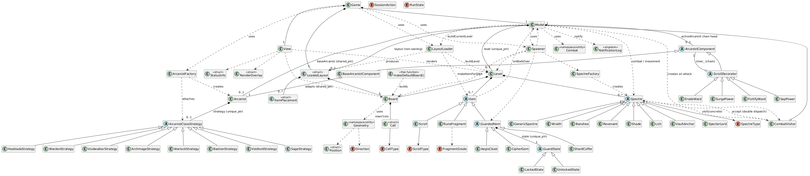

# RuneVault

A terminal dungeon crawler written in **C++14** for CS247. Choose an Arcanist, fight through five vault levels, collect Rune Fragments, and recover the Cipher Gem on each floor to reveal the way down.

The project focuses on object-oriented design: class abilities are strategies, temporary scroll effects form a decorator chain, and combat uses visitor dispatch for enemy-specific effects.

## Build and play

Requires a C++14 compiler and GNU Make. The game uses only the C++ standard library.

```sh
make
./build/runevault
```

On Windows, use MinGW-w64 with GNU Make from a Command Prompt or PowerShell. The executable is `build/runevault.exe`; `mingw32-make` can be used in place of `make`.

```sh
make run          # Build and start a session
make clean        # Remove build output
```

Choose `s` (Sage), `h` (Hexblade), `w` (Warden), or `v` (Voidwalker) at the class prompt.

| Command | Action |
| --- | --- |
| `no`, `so`, `ea`, `we` | Move north, south, east, or west |
| `ne`, `nw`, `se`, `sw` | Move diagonally |
| `a <direction>` | Attack an adjacent enemy |
| `u <direction>` | Use an adjacent scroll |
| `r` | Restart with a new class selection |
| `q` | Quit |

Successful actions give enemies a turn. Invalid commands and actions that do nothing do not consume a turn. Collect the gem dropped by a designated enemy, then step onto the revealed stairway. Clearing the fifth level wins the run.

### Options and demo layouts

```sh
./build/runevault -seed 42
./build/runevault -bonus
./build/runevault layouts/demo_positive_scrolls.txt -seed 42 -bonus
./build/runevault layouts/demo_fragments.txt 42
```

- `-seed <n>` / `--seed <n>` selects a reproducible random sequence. An explicit flag takes priority over the positional seed after a layout filename. Invalid seeds produce a warning and fall back to a time-based seed.
- `-bonus` / `--bonus` enables the per-turn notification board and a one-time class promotion after collecting 10 Rune Fragments.
- A layout filename supplies the map and item placements; actors are still spawned by the game. The same map is reused across the five levels.

The board is 79 columns by 25 rows, with five status rows below it. Important symbols are `@` (player), `?` (scroll), `*` (fragments), `C` (gem), `$` (coffer), `G` (cloak), and `\` (revealed stairs). Enemies use `W`, `B`, `R`, `S`, `L`, `A`, and `X`.

## Architecture and design patterns

`Game` reads commands and coordinates the session, `Model` owns game rules and run state, and `View` renders a snapshot. `Level` owns the current board, enemies, and items. Rendering is separate from state changes, and input/output streams can be injected into the controller for scripted sessions.

| Pattern | Application | Implementation |
| --- | --- | --- |
| Factory | Centralized construction of player classes, enemy types, and promoted class strategies | [ArcanistFactory](src/arcanist_factory.cpp), [SpectreFactory](src/spectre_factory.cpp), [PromotionFactory](src/promotion_factory.cpp) |
| Strategy | Interchangeable class rules for score, scroll effects, and damage modifiers; promotion replaces the strategy | [ArcanistClassStrategy](include/runevault/arcanist_class.h) |
| Decorator | Stackable Power and Ward buffs/debuffs wrap a shared base character; the chain resets on descent | [ArcanistComponent and scroll decorators](include/runevault/arcanist_component.h) |
| Visitor | `accept()` selects a concrete enemy overload; attacking a Lich triggers hostility, and defeating a Vault Anchor unlocks nearby treasure | [CombatVisitor](src/combat_visitor.cpp), [Spectre dispatch](src/spectre.cpp) |
| State | Guarded items delegate collection eligibility to `LockedState` or `UnlockedState` | [GuardState and GuardedItem](include/runevault/guarded_item.h) |
| Singleton | One notification buffer collects events for the controller to display and clear each turn | [NotificationLog](include/runevault/notification_log.h) |

The factories use explicit selection functions. They demonstrate centralized polymorphic construction rather than an inheritance-based GoF Factory Method hierarchy. `RunState` is a separate scoped enum; the object-based State implementation is the guarded-item hierarchy.

### C++ techniques in the code

| Topic | Concrete example |
| --- | --- |
| **RAII and ownership** | `Model` owns a `Level` through `std::unique_ptr`; each level owns items and enemies in vectors of unique pointers. Destruction releases these resources automatically. [Model](include/runevault/model.h), [Level](include/runevault/level.h) |
| **Move semantics** | `Level::addItem`, `addSpectre`, and `removeItemAt` transfer ownership with `std::move`. The level constructor moves its board into storage. These are standard-library moves; the project does not define custom move constructors. [level.cpp](src/level.cpp) |
| **Shared lifetimes** | The model and decorator chain hold `std::shared_ptr` references to the persistent Arcanist, allowing temporary effects to disappear while the character survives a level change. [arcanist_component.h](include/runevault/arcanist_component.h) |
| **Runtime polymorphism** | Abstract interfaces, virtual destructors, and `override` support class strategies, items, enemy types, and decorators. [Item](include/runevault/item.h), [Spectre](include/runevault/spectre.h) |
| **Generic programming** | Iterator-based `rng::shuffle` and container-based `rng::pick` use templates; trailing return types preserve the selected element's reference type. [shuffle.h](shuffle.h) |
| **STL algorithms and containers** | Enemy turns use `std::sort` with a lambda; spawning uses sets to track occupied coordinates; layout parsing uses a queue for flood-fill chamber detection. [model.cpp](src/model.cpp), [spawner.cpp](src/spawner.cpp), [layout_loader.cpp](src/layout_loader.cpp) |
| **Value types and const interfaces** | `Position` defines equality, scoped enums represent directions and item types, and the renderer accepts const model snapshots. [geometry.h](include/runevault/geometry.h), [view.h](include/runevault/view.h) |
| **Deterministic randomness** | A shared `std::mt19937` engine supports explicit seeds, weighted spawning, and standard-library distributions. [shuffle.cpp](shuffle.cpp) |

For a quick code tour, start with [Game::playLoop](src/game.cpp), follow an attack through [Model::handleAttack](src/model.cpp) and the visitor, then read the decorator chain and `Level` ownership methods.

## UML diagrams

The repository includes editable PlantUML sources and rendered diagrams. The overview is shown below; open the detailed diagrams for member signatures and relationships.



| Diagram | Image | PlantUML source |
| --- | --- | --- |
| Overview | [Open](UML/UML_Thumbnail/RuneVault.png) | [Source](UML/UML_Thumbnail.puml) |
| Complete class diagram | [Open](UML/UML/RuneVault.png) | [Source](UML/UML.puml) |
| Core model and controller | [Open](UML/UMLp1/RuneVault_Core.png) | [Source](UML/UMLp1.puml) |
| Decorators, visitors, and enemies | [Open](UML/UMLp2/RuneVault_Decorators_Visitors_Spectres.png) | [Source](UML/UMLp2.puml) |

After changing a `.puml` file, regenerate its image with PlantUML to keep the rendered documentation in sync.

## Custom maps

Layouts accept up to 25 rows and 79 columns. Short rows and omitted cells are padded as walls. Use `|` / `-` for walls, `.` for floor, `+` for archways, and `#` for corridors. Floor chambers are identified by orthogonal flood fill.

Digits place items on floor tiles:

| Digits | Items, in order |
| --- | --- |
| `0`, `1`, `2` | Attune Focus, Surge Power, Fortify Ward |
| `3`, `4`, `5` | Drain Focus, Sap Power, Erode Ward |
| `6`, `7`, `8`, `9` | Common Shard, Resonant Shard, Lich Cache, Shard Coffer |

Use the [demo layouts](layouts/) as starting points. Leave room for actor placement, stairs in a different chamber from the player, and an adjacent guardian for guarded treasure.

## Repository layout

```text
include/runevault/   Public headers and interfaces
src/                Game implementation
layouts/            Example maps
UML/                PlantUML sources and rendered diagrams
shuffle.h/.cpp      Shared random utilities
.kiro/specs/        Development requirements, design notes, and task history
```

## Validation and project status

GitHub Actions builds the game on Linux and checks basic scripted startup, bonus mode, and demo-layout loading. Locally, build with `make` and pipe a class choice followed by `q` into the executable for a quick startup check.

The current checkout has no `tests/` sources. `make test` reports that explicitly; it is not evidence of a passing regression suite. The Makefile retains test support for when those sources are available.

This is a coursework project. The design notes capture the intended rules and development history; the implementation is the reference for current behavior. In particular, enemy damage currently bypasses the class damage-modifier strategy, and cramped custom maps can prevent guardian or stairway placement. These remain areas for further work.
